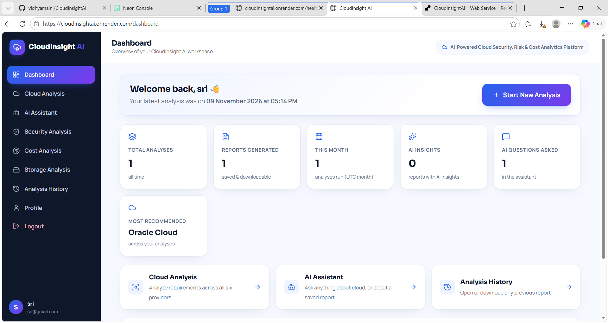
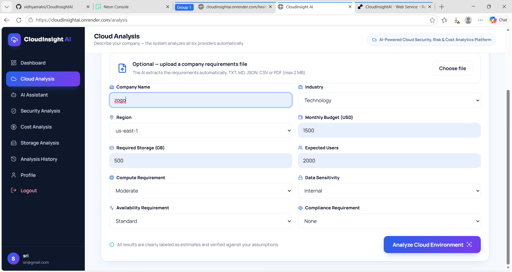
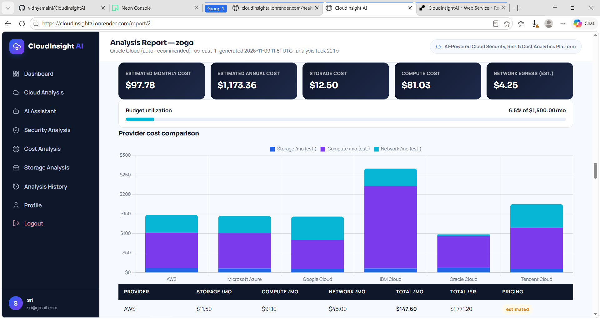
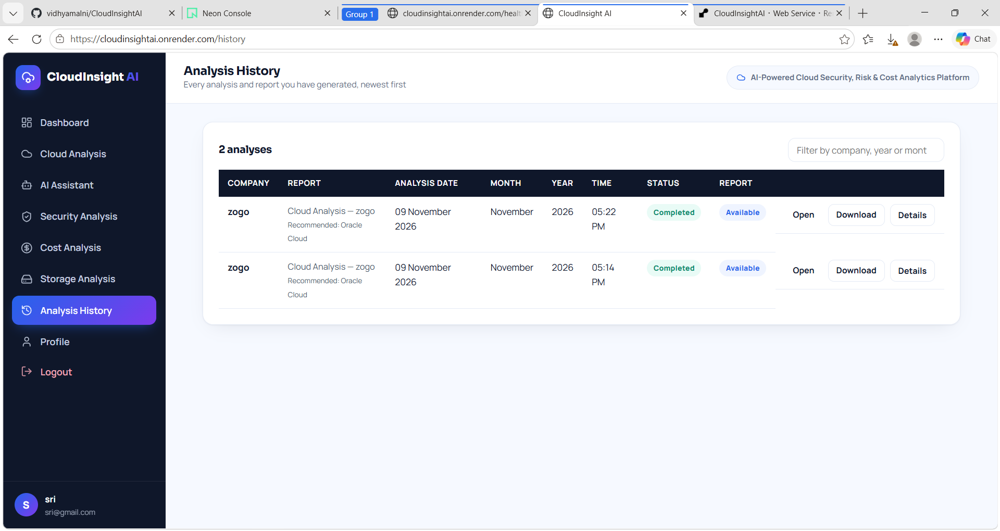
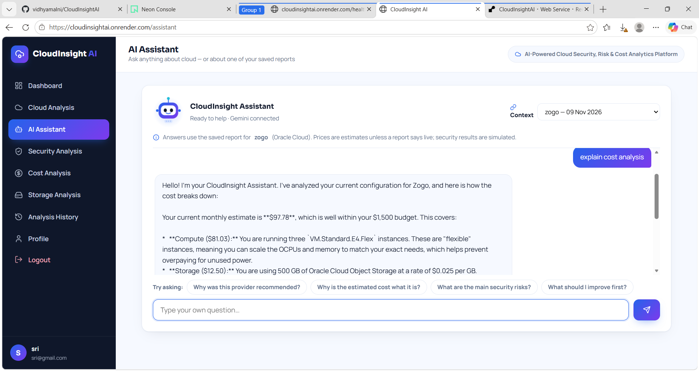

# CloudInsight AI

AI-assisted multi-cloud analysis: enter a company's requirements and CloudInsight AI scores AWS, Microsoft Azure,
Google Cloud, IBM Cloud, Oracle Cloud and Tencent Cloud, recommends the most suitable one, estimates cost, assesses
security posture, and generates a saved report (web + PDF). A Gemini-powered assistant answers cloud questions and
questions about a saved report.

## Live demo

**https://cloudinsightai.onrender.com**

Hosted on Render's free plan with a Neon PostgreSQL database. The free instance sleeps when idle, so the first
request after a quiet period can take about 50 seconds. Please use demo data; do not enter real company information.

## Screenshots

| Dashboard | New analysis |
|---|---|
|  |  |

| Report | Analysis history |
|---|---|
|  |  |

| AI assistant |
|---|
|  |

## Key features

* Requirement form with company profiles; scores six cloud providers and recommends one.
* Cost, storage, compute, security and risk sections in a saved report, plus PDF export.
* Analysis History: every analysis is saved per user and can be reopened later.
* Gemini assistant: general cloud Q&A, or questions scoped to one saved report.
* Per-user data isolation, CSRF protection, secure cookies, input validation, account lockout.
* 82 automated tests (unit, template, route and two-user isolation tests).

## Tech stack

Python, Flask, Flask-SQLAlchemy, Flask-Login, PostgreSQL (SQLite locally), ReportLab, Google Gemini (`google-genai`),
Azure Retail Prices API, gunicorn, Render, Neon.

## Honest scope

* **Pricing:** only Azure storage and compute are fetched live (Azure Retail Prices API). Everything else is a stored
  estimate in `data/pricing_baseline.json`, labelled `estimated`. Each report lists the source and timestamp per price.
* **Security analysis:** a *simulated, configuration-based* assessment from the requirements you enter. It is not a scan
  of a real cloud account.
* **Provider scores:** rule-based, from configured capability baselines. They are not live benchmarks.

## Run locally

```powershell
python -m venv venv
venv\Scripts\activate
pip install -r requirements.txt
copy .env.example .env      # then fill in SECRET_KEY and GEMINI_API_KEY (or put the key in GEMINI_API_KEY env var)
python app.py               # http://127.0.0.1:5000
```

Set `FLASK_DEBUG=1` only for local development. Without `SECRET_KEY`, a random key is generated once and stored in
`instance/.secret_key`.

## Tests

```powershell
python -m unittest discover -s tests -v
```

`tests/test_routes.py` needs Flask-Login and Flask-SQLAlchemy (installed via requirements.txt) and covers login,
two-user isolation, CSRF, history, dashboard and the assistant. `tests/live_azure_check.py` makes a real call to Azure.

## Configuration

| Variable | Purpose |
|---|---|
| `SECRET_KEY` | Session signing key (required in production) |
| `GEMINI_API_KEY` | Gemini assistant / extraction. Never commit it |
| `DATABASE_URL` | PostgreSQL URL in production. Default: SQLite in `instance/` |
| `SESSION_COOKIE_SECURE` | `1` when served over HTTPS |
| `PRICING_LIVE` | `0` disables live Azure pricing calls |
| `FLASK_DEBUG` | `1` enables debug mode (local only) |

## Deploy (Render + Neon example)

1. Push the repo to GitHub (`.env`, `instance/` and key files are git-ignored).
2. Create a free PostgreSQL database (for example on Neon) and copy its connection string.
3. Create a **Web Service** from the repo: build command `pip install -r requirements.txt -r requirements-prod.txt`,
   start command `gunicorn app:app --workers 2 --timeout 120`, health check path `/healthz`.
4. Set environment variables: `SECRET_KEY`, `GEMINI_API_KEY`, `DATABASE_URL`, `SESSION_COOKIE_SECURE=1`,
   `PYTHON_VERSION=3.12.8`.
5. Do not rely on SQLite or local files in production: free hosting disks are wiped on redeploy.

`postgres://` and `postgresql://` URLs are rewritten to `postgresql+psycopg2://` automatically.
Tables are created on startup (`db.create_all()`), which adds missing tables but never alters or deletes existing data.
Add a migration tool (Flask-Migrate) before changing the schema.

## Known limitations

* No live pricing for AWS, GCP, IBM, Oracle or Tencent yet; no database-service cost.
* No rate limiting on login/contact beyond a per-account lockout.
* Not verified for production load; no monitoring or automated backups configured.
